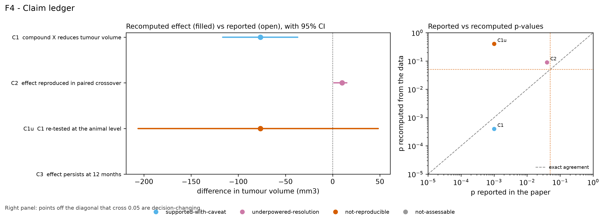
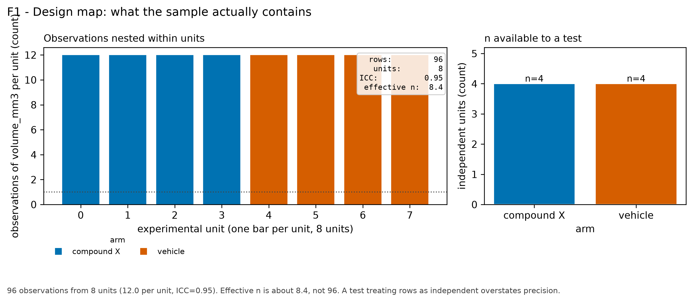
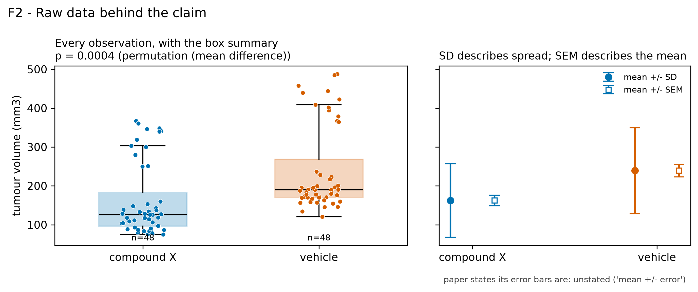
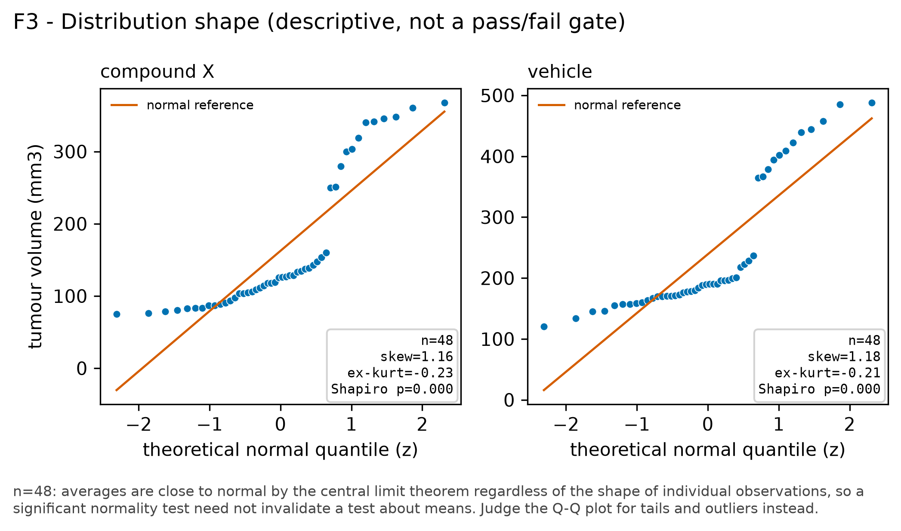
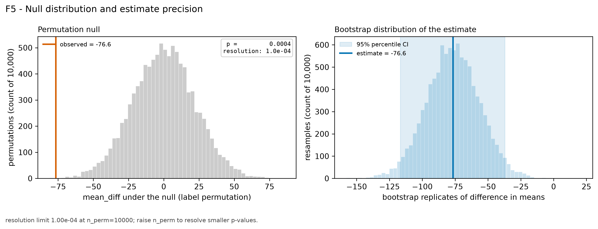
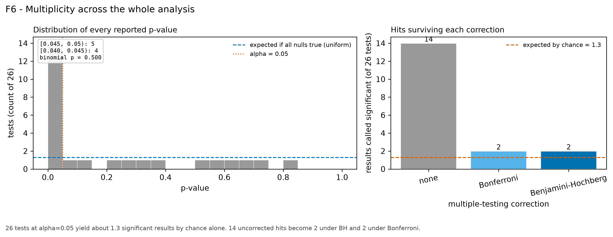
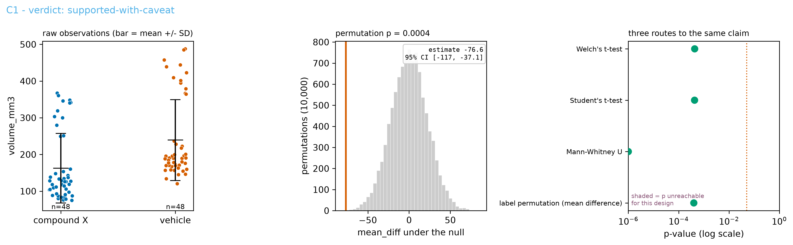
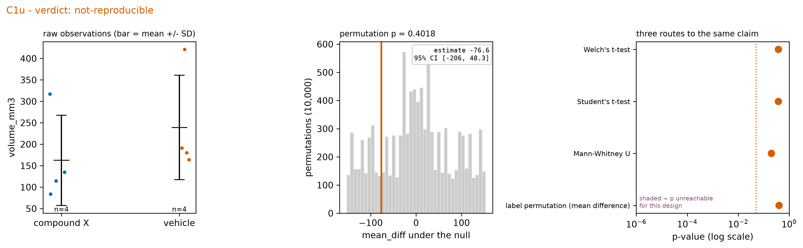
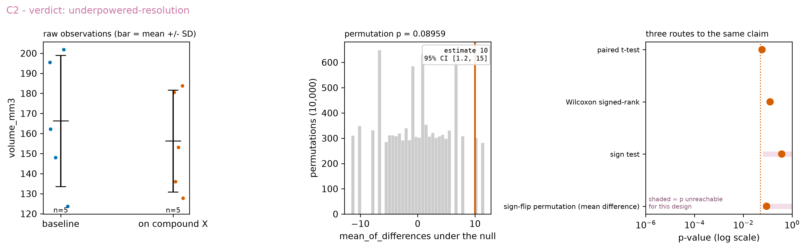

# Statistical Review - Compound X reduces tumour burden in a syngeneic model

*Reviewer: statistical-review skill (demonstration run) · Protocol: statistical-review v1*

---

## 1. Inputs and coverage

| Input | Value |
|-------|-------|
| Manuscript | `manuscript.pdf` - 1 page(s), text layer usable (1623 chars/page) |
| Raw data (Figure 1) | `figure1_fields.csv` - 96 rows, sha256 `2cba77ceb45861fd...` |
| Raw data (Figure 2) | `figure2_crossover.csv` - sha256 `c8303d3628dbcbf1...` |
| Parsed from the PDF | 4 test statistics, 26 p-values |
| Claims with no supporting data | C3 - reported as `not-assessable` |
| Seeds | `random_state=0`, `n_perm=10000`, `n_boot=10000` |

This review covers 3 of the paper's claims; C3 could not be assessed with the supplied data.

---

## 2. Summary of findings

| Verdict | Claims |
|---------|--------|
| `supported-with-caveat` | 1 |
| `not-reproducible` | 1 |
| `underpowered-resolution` | 1 |
| `not-assessable` | 1 |

1. **C1 is pseudoreplicated.** The paper states *n = 4 per group* but reports *t(94)*, degrees of freedom consistent with a test on all 96 measurement fields. Fields cluster strongly within animal (ICC = 0.95, 12 per animal), giving an effective n of about 8.4. Re-tested at the animal level (C1u) the permutation p is 0.402 against the reported 0.001.
2. **C2 reports a p-value its design cannot produce.** With 5 pairs the sign-flip permutation floor is p >= 0.0625 and the sign test cannot go below 0.0625; the paper reports p = 0.040.
3. **No correction was applied across 26 reported p-values**, where about 1.3 significant results are expected by chance alone. 14 uncorrected hits become 2 under Benjamini-Hochberg and 2 under Bonferroni.

---

## 3. Claim ledger



*Recomputed effect (filled) against reported (open) with 95% bootstrap CI; right, reported against recomputed p-values on log axes with alpha = 0.05 marked.*

| id | claim | verdict | effect recomp. | 95% CI | p rep. | p recomp. |
|----|-------|---------|----------------|--------|--------|-----------|
| C1 | compound X reduces tumour volume | `supported-with-caveat` | -76.6 | [-116.6, -37.1] | 0.001 | 0.0004 |
| C1u | C1 re-tested at the animal level | `not-reproducible` | -76.6 | [-206.2, 48.3] | 0.001 | 0.4018 |
| C2 | effect reproduced in paired crossover | `underpowered-resolution` | 10.0 | [1.2, 15.0] | 0.040 | 0.0896 |
| C3 | effect persists at 12 months | `not-assessable` | - | - | - | - |

Reasons, per claim:

- **C1**: 96 observations from 8 units (12.0 per unit, ICC=0.95). Effective n is about 8.4, not 96. A test treating rows as independent overstates precision.
- **C1u**: reported p = 0.001 and recomputed p = 0.402 fall on opposite sides of alpha = 0.05; every route agrees with the recomputed value
- **C2**: the design's permutation floor is p >= 0.0625, so no result from it can reach alpha = 0.05 | the reported p = 0.04 is below that floor; recomputing gives p = 0.0896
- **C3**: no longitudinal data supplied; source data cover the 4-week endpoint only

---

## 4. Design and sampling - stages 1-2



*Left: measurement fields per animal. Right: independent animals per arm, the n available to a test.*



*Every field with its box summary; right panel shows mean +/- SD against mean +/- SEM on the same axis.*

**Population.** The methods state only that animals were female and vivarium-housed. Strain, age and facility are not given, so the population the claim covers cannot be pinned down from the manuscript.

**Unit of replication.** 96 observations from 8 units (12.0 per unit, ICC=0.95). Effective n is about 8.4, not 96. A test treating rows as independent overstates precision. The reported *t(94)* is consistent with a test on measurement fields; a two-sample test on the 8 animals has 6 degrees of freedom.

**Uncertainty reporting.** The paper writes "mean +/- error" without saying which quantity the bars represent. SD and SEM differ by sqrt(n) here, so the figure cannot be read as drawn.

---

## 5. Method and assumptions - stages 3-4



*Q-Q per arm with n, skewness, excess kurtosis and the Shapiro-Wilk p-value. Descriptive, not a pass/fail gate.*

**Test selection.** The paper names Student's equal-variance t-test. variance ratio 1.36: the equal-variance assumption is not contradicted. The crossover cohort is analysed with Wilcoxon signed-rank, which assumes the paired differences are symmetric; the sign test makes no such assumption and is reported alongside below.

**Three routes, C1 at the animal level (C1u):**

| route | test | p | assumes |
|-------|------|---|---------|
| parametric | Welch's t-test | 0.3786 | group means normal; unequal variances allowed |
| parametric | Student's t-test | 0.3779 | normal; equal variances |
| non-parametric (ranks) | Mann-Whitney U | 0.2000 | independence; tests which group tends to be larger, not equality of medians |
| permutation | label permutation (mean difference) | 0.4018 | exchangeability: identical distributions under the null |

**Three routes, C2 (paired, 5 subjects):**

| route | test | p | smallest p this design allows |
|-------|------|---|-------------------------------|
| parametric | paired t-test | 0.0584 | 0.0000 |
| non-parametric (ranks) | Wilcoxon signed-rank | 0.1250 | 0.0000 |
| non-parametric (signs) | sign test | 0.3750 | 0.0625 |
| permutation | sign-flip permutation (mean difference) | 0.0896 | 0.0625 |

---

## 6. Resolution and evidence - stage 5



*Permutation null with the observed statistic marked, annotated with the p-value, the resolution limit and the design floor where it binds; right, the bootstrap distribution of the estimate with its interval.*

**C1 (field level).** resolution limit 1.00e-04 at n_perm=10000; raise n_perm to resolve smaller p-values.

**C1u (animal level).** 4 vs 4 animals gives a two-sided permutation floor of 0.0286; observed p = 0.4018. Bootstrap difference in means -76.6 mm3, 95% CI [-206.2, 48.3].

**C2 (paired, 5 subjects).** design floor is p >= 0.0625: this comparison cannot reach p < 0.05 by permutation regardless of effect size.

**Shuffling scheme.** The manuscript does not state how, or whether, any permutation was performed; the p-values above come from this review, permuting labels across animals for C1u and flipping signs within subject for C2.

---

## 7. Multiplicity - stage 6



*p-value histogram against the uniform expectation with the just-below-threshold window highlighted; right, hits surviving each correction against the number expected by chance.*

| correction | controls | n significant | threshold on raw p |
|------------|----------|---------------|--------------------|
| none | nothing (per-test error rate) | 14 | 0.05 |
| Bonferroni | FWER: probability of any false positive | 2 | 0.001923 |
| Benjamini-Hochberg | FDR: expected fraction of false calls <= 0.05 | 2 | 0.001 |

**Counting.** 26 tests at alpha=0.05 yield about 1.3 significant results by chance alone. 14 uncorrected hits become 2 under BH and 2 under Bonferroni. The methods state that no correction was applied.

**Distribution of reported p-values.** 5 p-values in (0.045, 0.05) vs 4 in the equally wide (0.04, 0.045) (one-sided binomial p = 0.500). This diagnostic describes the set of reported p-values and says nothing about any individual result; it cannot distinguish analytic flexibility from legitimate exploratory analysis, and rounding conventions alone can produce apparent pile-up. The full set of comparisons run, or a pre-specified analysis plan, would resolve it.

---

## 8. Per-claim supplement



*C1 - compound X reduces tumour volume; verdict `supported-with-caveat`. Raw observations, permutation null, and the three routes. Shaded region marks p-values unreachable for this design.*



*C1u - C1 re-tested at the animal level; verdict `not-reproducible`. Raw observations, permutation null, and the three routes. Shaded region marks p-values unreachable for this design.*



*C2 - effect reproduced in paired crossover; verdict `underpowered-resolution`. Raw observations, permutation null, and the three routes. Shaded region marks p-values unreachable for this design.*

---

## 9. What was not assessed

Diagnostics in this report describe distribution shape and spread only. They cannot evaluate:
  - independence of observations
  - the sample is representative of the stated population
  - absence of unmeasured confounding
  - measurements were not selected after seeing the outcome
These are design questions. Assess them from the methods section, and say so explicitly when the methods do not contain enough information to assess them.

Additionally:

- C3 ("effect persists at 12 months"): no longitudinal data supplied.
- The paper's own model fit could not be reconstructed; only the group comparisons were re-derived.
- Blinding and randomization are not described in the methods, so neither was assessed.

---

## 10. Reproduction

```bash
python examples/run_demo_review.py --outdir examples/demo_output
```

| | |
|--|--|
| Seeds | `random_state=0` |
| Permutations / resamples | `n_perm=10000`, `n_boot=10000` |
| Package versions | numpy 2.4.6, pandas 2.3.3 |
| Manuscript checksum | sha256 `d23e71f09ec4c8f8...` |
| Skill version | statistical-review v1 |

---

*Findings in this report are arithmetic statements about reported and recomputed values. Where they differ, the cause is often an input the review could not see; the inputs used are named above so that discrepancies can be resolved.*
