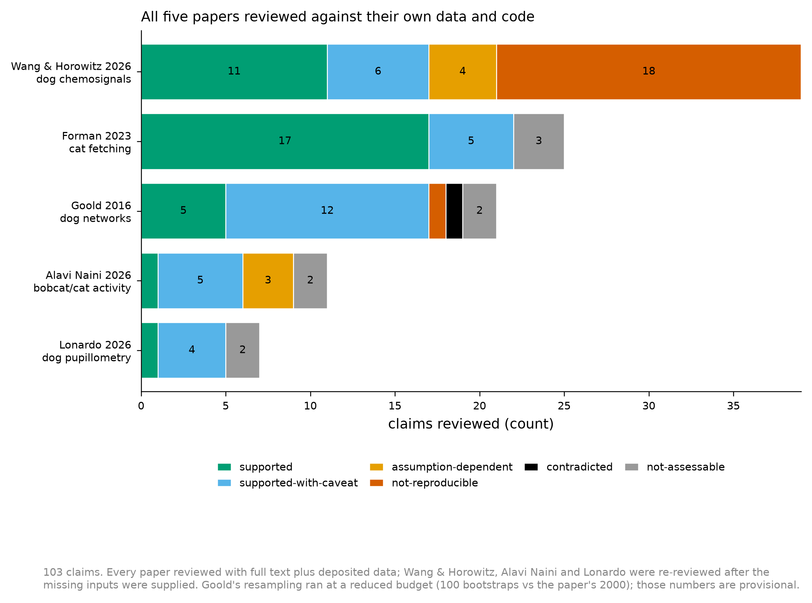

# Statistical review batch - five companion-animal behaviour papers

Produced by the `statistical-review` skill via five `STAT_REVIEWER` sub-agents. Per-paper reports in `reports/<slug>/REVIEW_REPORT.md`, figures in `figures/<slug>/`, ledgers and recomputed values in `results/<slug>/`, regenerating scripts in `src/`.

## Inputs

All five were reviewed with full text plus the authors' deposited data. Three required a second pass after the user supplied inputs that could not be retrieved programmatically (Dryad gates file downloads; Cognition is paywalled).

| Paper | Text | Data | Authors' code |
|---|---|---|---|
| Goold 2016 | PMC | Zenodo mirror of Dryad | Rscript.R |
| Forman 2023 | publisher PDF | Supplementary S3 (1154 cats) | Supplementary S2 (2nd pass) |
| Lonardo 2026 | PDF (2nd pass) | Zenodo parquet | .Rmd analyses |
| Wang & Horowitz 2026 | PMC | Dryad (2nd pass) | statistical_analyses.R |
| Alavi Naini 2026 | PMC | Dryad (2nd pass) | MATLAB + R |

## Verdicts

| Paper | Claims | supported | supported-with-caveat | assumption-dependent | underpowered-resolution | not-reproducible | contradicted | not-assessable |
|---|---|---|---|---|---|---|---|---|
| Forman 2023 - cat fetching survey | 25 | 17 | 5 | 0 | 0 | 0 | 0 | 3 |
| Goold 2016 - dog behaviour networks | 21 | 5 | 12 | 0 | 0 | 1 | 1 | 2 |
| Lonardo 2026 - dog pupillometry | 7 | 1 | 4 | 0 | 0 | 0 | 0 | 2 |
| Wang & Horowitz 2026 - dog chemosignals | 39 | 11 | 6 | 4 | 0 | 18 | 0 | 0 |
| Alavi Naini 2026 - bobcat/cat diel activity | 11 | 1 | 5 | 3 | 0 | 0 | 0 | 2 |

## What the second pass changed

- **Wang & Horowitz**: 39/39 not-assessable -> 11 supported, 6 caveat, 4 assumption-dependent, 18 not-reproducible. The first pass inferred from Wilcoxon/Kruskal-Wallis ceilings that both Parts tested the wrong unit. Data confirmed it for Part 2 (the central attachment claim falls from p<0.001 to 0.231 at dog level) and REFUTED it for Part 1 (ICC 0.002, every conclusion intact). Its own negative control flips: p=0.087 on trials, 0.013 on dogs.
- **Alavi Naini**: every statistic reproduced exactly, and the finding came from reading the deposited code - the published U2 values use a fixed UTC-6 clock while the overlap values are DST-aware, and the Methods' solar-time conversion appears in neither.
- **Lonardo**: two first-pass verdicts WITHDRAWN as reviewer error. The paper discloses the 28-vs-39 sample split and reports the N=39 null itself; and it makes no per-gesture significance claim.
- **Forman**: the authors' R code surfaced a sensitivity run that crosses alpha (p=0.02865) where the reported run does not (0.09177), against a Methods statement that interpretation was unaffected.

## Provisional numbers

Goold's resampling ran at a reduced budget (100 bootstrap networks vs the paper's 2000, 6 case-drop replicates) after the shared machine saturated; its bootstrap s.d. discrepancy is flagged provisional in its own report. Every per-paper report states its coverage in section 1 and what it could not check in section 9.
